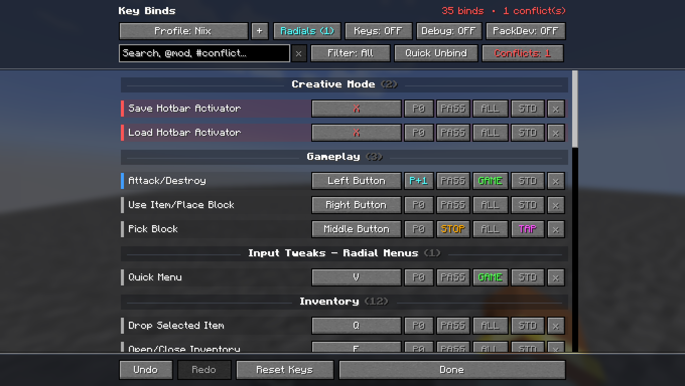
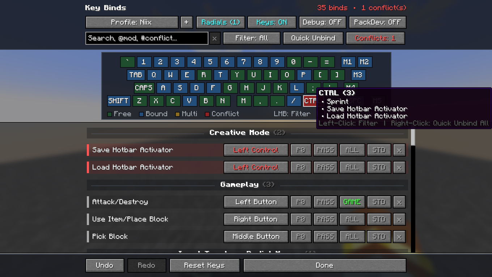
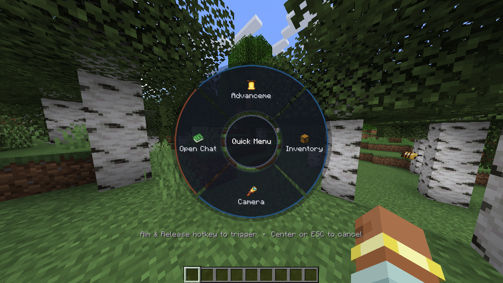
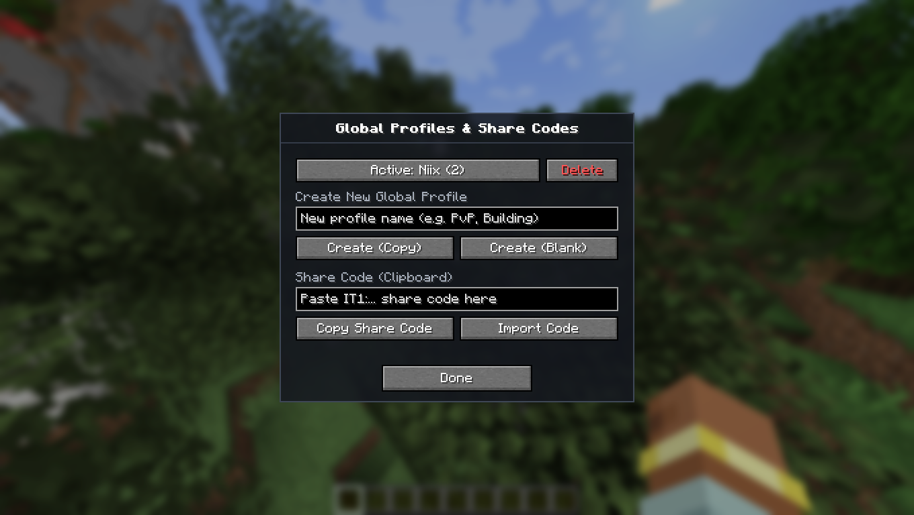
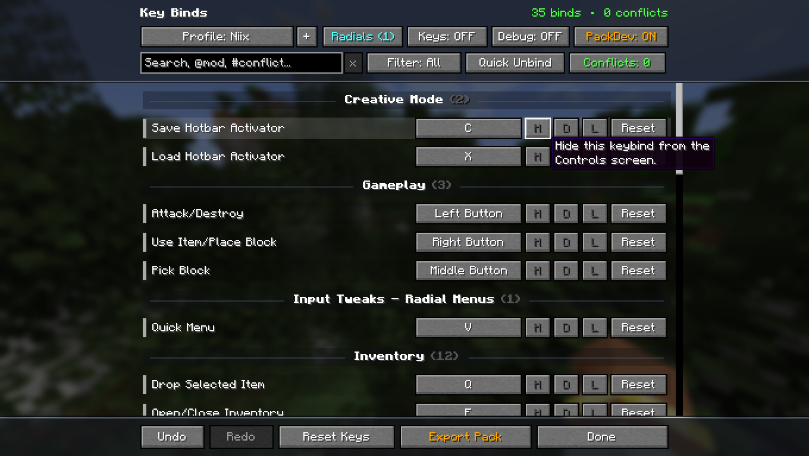
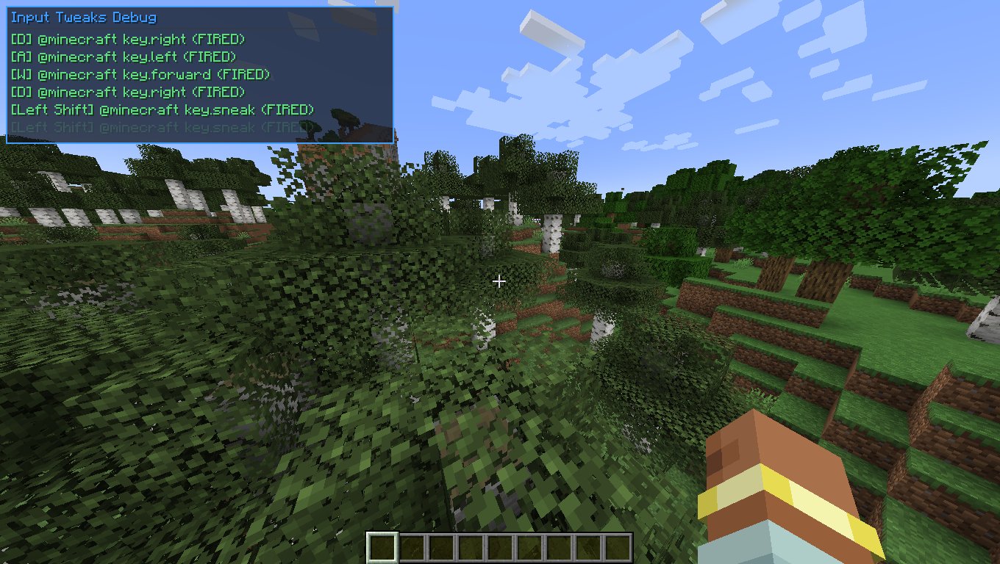

# Input Tweaks

[](https://github.com/Niix-Dan/InputTweaks/stargazers)
[](https://github.com/Niix-Dan/InputTweaks/issues)
[](https://github.com/Niix-Dan/InputTweaks/releases)
[](https://github.com/Niix-Dan/InputTweaks)
[](https://github.com/Niix-Dan/InputTweaks)


[](https://www.curseforge.com/minecraft/mc-mods/input-tweaks)

**Input Tweaks** is a client-side Minecraft mod for **(Fabric, Forge & NeoForge)** that expands the vanilla Key Binds screen with conflict management, priorities, contexts, trigger modes, visual radial menus, cross-modpack profiles, and tools for modpack creators.

It keeps the familiar layout of the vanilla Controls menu while adding practical tools for managing large modpacks on keyboard and mouse.



---

## Features

### Keybind Management & Conflict Handling
* **Context-Aware Conflict Detection:** Assign a context to any keybind (`ALL`, `GAME`, `GUI`, `RIDE`, `FLY`, `SNK`). Keys that do not overlap (such as a `GUI` bind and an `IN_GAME` bind, or `TAP` and `HOLD` on the same key) are not flagged as conflicts.
* **Priority Binds & Input Policy:** Set a numeric priority (`P0`, `P+1`, `P-1`, etc.) for binds sharing the same key, and choose between `PASS` (let lower-priority actions run too) or `STOP` (consume the key press so lower-priority actions do not trigger).
* **Trigger Modes:** Change how any keybind activates:
    * `STD` — Standard press
    * `TAP` — Quick tap (released within 240 ms)
    * `HOLD` — Held key (held for at least 260 ms)
    * `2X` — Double-tap (pressed twice within 320 ms)
    * `TOG` — Forces any keybind to behave as a toggle
* **Modifier Combos (Chords):** Bind `Ctrl`, `Alt`, or `Shift` combined with any keyboard key or mouse button, while still allowing standalone modifier keys (such as `Left Shift` for Sneak).
* **Quick Unbind:** Click **Quick Unbind** and press any key or mouse button to unbind every action assigned to it at once.
* **Conflict Wizard:** Click **Conflicts** to step through real conflicting keys one by one.
* **Undo / Redo & Safe Reset:** Full `Ctrl+Z` / `Ctrl+Y` history (up to 128 actions) and a 2-click confirmation on **Reset All**.

### Visual Keyboard Heatmap
Toggle the interactive keyboard and mouse map (`Keys: ON/OFF`) above the controls list to see key usage at a glance:



| Color | Meaning |
| :--- | :--- |
| **Green** | Free (no actions assigned) |
| **Blue** | Bound (single action) |
| **Amber** | Multi-context (multiple actions with no real conflict) |
| **Red** | Real conflict (overlapping contexts on the same key) |

* **Left-Click** a key to filter the list to that key.
* **Right-Click** a key to **Quick Unbind** all actions on it.

### Radial Menus & In-Game Visual Editor
Group less-used keybinds (quest books, maps, menus, camera toggles) onto a single hotkey using circular radial menus:
* **Circular Wheel Overlay:** Animated wheel with item icons, colored slice borders, hover highlight, and a pointer arrow that follows the cursor.
* **Two Activation Modes:**
    * **Hold & Release:** Hold the wheel hotkey, aim at a slice, and release to trigger.
    * **Toggle & Click:** Press to open, left-click a slice to trigger (right-click or `ESC` to cancel).
* **Visual Editor (`Radials` button):** Create and edit wheels (up to 12 slices each) with a live interactive circular preview, a searchable **Keybind Picker**, a searchable **Item Icon Picker** (supports vanilla and modded items), 8 accent colors, and a **Test Wheel** preview button.
* **Player & Modpack Scopes:** Save personal wheels globally (**My Radials**) or author default wheels for a modpack (**Pack Defaults**).



### Global Profiles & Share Codes
* **Cross-Modpack Global Profiles:** Player profiles and personal radial menus are saved in your OS user configuration folder so they automatically appear in every modpack that includes Input Tweaks.
* **Configuration Layering:** Settings resolve cleanly in this order (higher overrides lower):
    1. **Mod Default**
    2. **Modpack Rules** (`config/inputtweaks/modpack_rules.json`)
    3. **Global Profile** (user config folder)
    4. **Local Instance Override** (`config/inputtweaks/local_overrides.json`)
* **Share Codes:** Export or import any profile in one click as a compressed `IT1:...` text code via clipboard.



### Modpack Creator Tools (`PackDev` Mode)
Toggle **PackDev: ON** in the Controls screen to manage noisy mod keybinds without editing JSON files by hand:
* **Hide (`H`):** Hides a keybind from the Controls screen.
* **Hard-Disable (`D`):** Blocks a keybind completely in the input dispatcher.
* **Lock (`L`):** Prevents players from rebinding a keybind.
* **Export Pack:** Saves all rules and Pack Default radial menus directly to `config/inputtweaks/modpack_rules.json`.



### Diagnostics & Usage Tracking
* **Debug HUD (`Debug: ON/OFF`):** Displays a small live overlay in-game showing the pressed key, `@modid`, bind ID, and result (`VANILLA`, `FIRED`, `CONSUMED`, `BLOCKED`).
* **Unused Bind Tracker:** Locally counts how many times each bind is triggered (`usage_stats.json`) so you can filter unused binds with `#unused`.



---

## Controls & Shortcuts Reference

### Search Bar Syntax

| Query | Matches |
| :--- | :--- |
| `text` | Action name, category, bound key, mod ID, or bind ID |
| `@modid` | All keybinds belonging to a specific mod |
| `#conflict` | Keybinds with real conflicts |
| `#unbound` | Unbound keybinds |
| `#modified` | Keybinds changed from their defaults |
| `#unused` or `#dead` | Bound actions with `0` recorded uses |
| `#hidden` | Keybinds hidden or disabled by modpack rules |

### Mouse & Keyboard Shortcuts in the Controls Screen

| Target | Left-Click | Right-Click / Modifier |
| :--- | :--- | :--- |
| **Key Button** | Capture new key / combo | **Right-Click:** Unbind |
| **Priority (`P0`)** | Increase priority (`+1`) | **Right-Click** or **Shift+Click:** Decrease (`-1`) |
| **Policy (`PASS`/`STOP`)** | Toggle policy | **Right-Click:** Toggle policy |
| **Context (`ALL`, `GAME`, ...)** | Next context | **Right-Click** or **Shift+Click:** Previous context |
| **Trigger (`STD`, `TAP`, ...)** | Next trigger mode | **Right-Click** or **Shift+Click:** Previous mode |
| **Clear / Reset (`x` / `R`)** | Unbind (or reset if unbound) | **Right-Click** or **Shift+Click:** Reset to default |
| **Heatmap Key** | Filter list by key | **Right-Click:** Quick Unbind all actions on key |
| **Screen** | — | **`Ctrl+Z` / `Ctrl+Y`:** Undo / Redo |

---

## File Locations & Data Privacy

Input Tweaks is **100% client-side** and **does not connect to the internet**.

To allow your personal profiles and radial menus to carry over between different modpacks and launchers, Input Tweaks stores plain JSON files in your operating system's standard user configuration folder:

| Operating System | Global Profiles & Radials Directory |
| :--- | :--- |
| **Windows** | `%APPDATA%\InputTweaks\` |
| **macOS** | `~/Library/Application Support/InputTweaks/` |
| **Linux / Steam Deck** | `$XDG_CONFIG_HOME/InputTweaks/` (defaults to `~/.config/InputTweaks/`) |

Inside that folder, only the following files are created:
* `profiles/<ProfileName>.json` — Your global keybind profiles
* `radials.json` — Your personal global radial menus

Per-instance files are stored inside the standard Minecraft config directory:
* `config/inputtweaks/modpack_rules.json` — Modpack creator rules & default radial menus
* `config/inputtweaks/local_overrides.json` — Optional instance-only overrides
* `config/inputtweaks/active_profile.txt` — Last selected profile name for this instance
* `config/inputtweaks/usage_stats.json` — Local usage counters for the `#unused` filter

---

## Modpack Configuration (`modpack_rules.json`)

You can generate this file in-game using **PackDev Mode** and the **Radial Menu Editor**, or edit `config/inputtweaks/modpack_rules.json` directly:

```json
{
  "schemaVersion": 1,
  "rules": {
    "key.examplemod.unused_menu": {
      "hidden": true,
      "hardDisabled": true,
      "locked": false
    },
    "key.examplemod.ability": {
      "hidden": false,
      "hardDisabled": false,
      "locked": true,
      "defaultKey": "key:82",
      "defaultModifiers": ["key:342"],
      "categoryOverride": "key.categories.gameplay"
    }
  },
  "radialMenus": [
    {
      "id": "pack_utilities",
      "title": "Pack Menu",
      "defaultKey": "key:86",
      "activationMode": "HOLD_RELEASE",
      "slots": [
        {
          "label": "Advancements",
          "targetBindId": "key.advancements",
          "icon": "minecraft:knowledge_book",
          "color": "#409EFF"
        },
        {
          "label": "Perspective",
          "targetBindId": "key.togglePerspective",
          "icon": "minecraft:spyglass",
          "color": "#36CFC9"
        }
      ]
    }
  ]
}
```

* **Key format:** `"key:<GLFW_KEY_CODE>"` (e.g., `"key:86"` = `V`, `"key:82"` = `R`, `"key:342"` = `Left Alt`), `"mouse:<BUTTON>"` (e.g., `"mouse:3"` = `Mouse 4`), or `"unbound"`.
* **Activation modes:** `"HOLD_RELEASE"` or `"CLICK"`.

---

## Compatibility & FAQ

* **Does this need to be installed on servers?**
  No. Input Tweaks is completely client-side.
* **Does it support controllers / gamepads?**
  No. Input Tweaks focuses exclusively on keyboard and mouse input.
* **Can I include Input Tweaks in my modpack?**
  Yes! You are welcome to include it in any CurseForge or Modrinth modpack, and ship a custom `config/inputtweaks/modpack_rules.json` with your pack.
* **Will it work with other mods' keybinds?**
  Yes, any mod that registers standard Minecraft `KeyMapping` entries will appear automatically. Mods that read raw GLFW input directly inside custom screens may bypass priority/disable rules for those specific screens.

---

## Building from Source

Requirements: **Java 21** and Gradle.

```bash
git clone https://github.com/Niix-Dan/InputTweaks.git
cd InputTweaks
./gradlew build
```

Built jars will be output in each loader subproject's `build/libs/` directory.

---

## Links & Support

* **Source Code:** [github.com/Niix-Dan/InputTweaks](https://github.com/Niix-Dan/InputTweaks)
* **Issue Tracker:** [Report a Bug or Request a Feature](https://github.com/Niix-Dan/InputTweaks/issues)